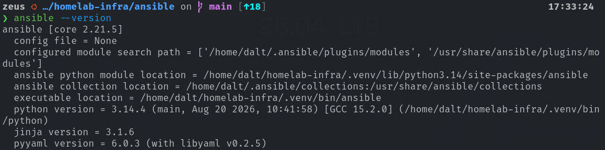
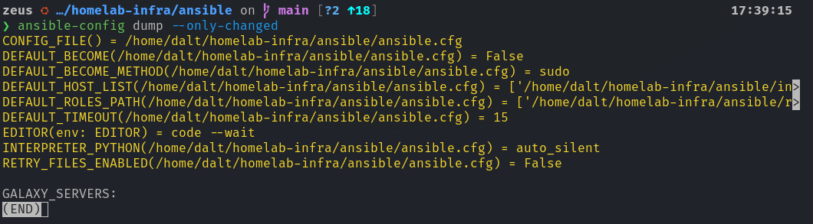
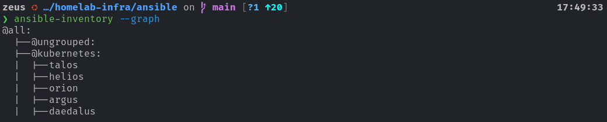
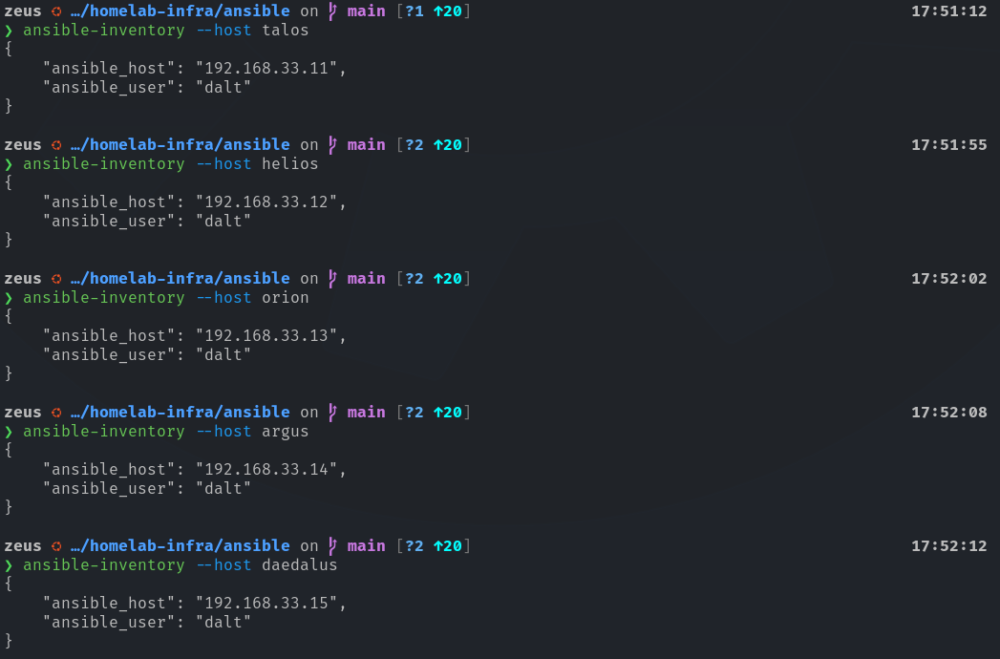
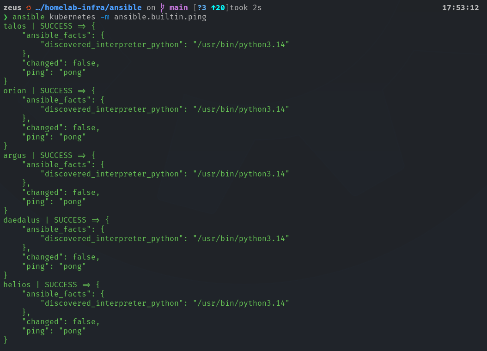
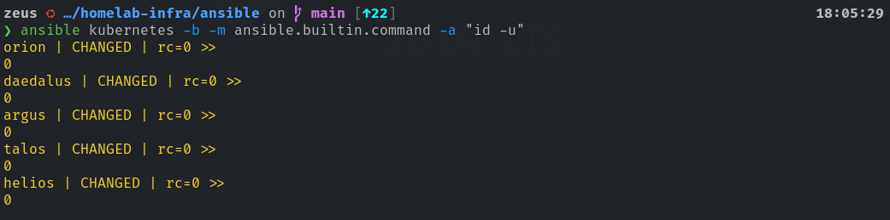

# Ansible Controller & Inventory Setup

## 1. Overview

This document outlines the initial implementation of Ansible within the homelab infrastructure repository. Ansible provides the homelab with a centralized, agentless configuration management center for the Kubernetes infrastructure being deployed.

The initial deployment establishes a dedicated Ansible controller, prod inventory, SSH authentication, privilege escalation, and connectivity validation. The foundation that is built in this document will eventually support automated Linux configuration, system maintenance, security hardening, and Kubernetes node prep.

### Environment

| **Component** | **Configuration** |
| --- | --- |
| Controller | `zeus` |
| Controller OS | Ubuntu-based Linux |
| Python | 3.14.4 |
| Ansible Core | 2.21.5 |
| Virtual Environment | `~/homelab-infra/.venv` |
| Configuration Directory | `~/homelab-infra/ansible` |
| Managed Systems | Five Kubernetes nodes |
| SSH User | `dalt` |
| Privilege Escalation | sudo |

## 2. Controller Installation

Ansible is installed on `zeus`, which serves as the control node for all infrastructure.

A Python virtual environment was selected over system-wide Ansible installation to isolate dependencies from the host OS and allow explicit control over Ansible versions.

### 2.1 Install Prerequisites

```bash
sudo apt update
sudo apt install -y python3-venv python3-pip
```

### 2.2 Create the Virtual Environment

```bash
cd ~/homelab-infra

python3 -m venv .venv
source .venv/bin/activate
```

### 2.3 Install Ansible

Install the selected Ansible Core version:

```bash
python -m pip install 'ansible-core==2.21.5'
```

**Verify installation**:

```bash
ansible --version
ansible-playbook --version
```

The installation was verified using Ansible Core 2.21.5 and Python 3.14.4, with executables located inside the repository's virtual environment.

### 2.4 Git Exclusion

The virtual environment must not be committed to source control. **The repository's [`.gitignore](/.gitignore) contains**:

```.gitignore
.venv/
__pycache__/
*.pyc
```

The `.venv` directory was verified as untracked using:

```bash
git ls-files .venv/
git check-ignore -v .venv/bin/ansible
```

> [!IMPORTANT]
> Only source configuration and dependency definitions should be version-controlled. The virtual environment itself remains local to the controller.

## 3. Ansible Project Configuration

Ansible uses a project-specific configuration file to establish consistent execution settings.

**Location**: [`ansible/ansible.cfg`](/ansible/ansible.cfg)

```ansible.cfg
[defaults]
inventory = inventories/prod/hosts.yml
roles_path = roles
interpreter_python = auto_silent
retry_files_enabled = False
timeout = 15

[privilege_escalation]
become = False
become_method = sudo
```

### Configuration Decisions

| **Parameter** | **Purpose** |
| --- | --- |
| `inventory` | Defines the production inventory used by default |
| `roles_path` | Specifies location of reusable configuration roles |
| `interpreter_python` | Enabled automatic remote Python interpreter discovery |
| `retry_files_enabled` | Prevents creation of retry files |
| `timeout` | Sets the connection timeout to 15sec |
| `become` | Disables automatic privilege escalation globally |
| `become_method` | Specifies *sudo* for privileged operations |

> [!NOTE]
> Privilege escalation is deliberately disabled by default. Administrative operations must explicitly request elevated privileges, reducing unnecessary use of root permissions.

### 3.1 Configuration Discovery

Ansible discovers the project configuration when commands are executed from the [`ansible/`](/ansible/) directory:

```bash
cd ~/homelab-infra/ansible
ansible --version
```



The output confirms:

```text
config file = /home/dalt/homelab-infra/ansible/ansible.cfg
```

### 3.2 Verify Active Settings

The effective configuration can be inspected using:

```bash
ansible-config dump --only-changed
```



This reports settings that **differ from Ansible's defaults**, including the inventory path, role path, timeout, privilege-escalation configuration, and Python interpreter discovery.

> [!NOTE]
> The active configuration **depends on Ansible discovering the intended `ansible.cfg`**. Commands should be executed from the project Ansible directory or with the `ANSIBLE_CONFIG` environment variable set appropriately.

## 4. Production Inventory

The initial production inventory contains **five Kubernetes nodes connected to VLAN 33**.

**Location**: [ansible/inventories/prod/hosts.yml](/ansible/inventories/prod/hosts.yml)

### 4.1 Managed Hosts

| **Node** | **Hostname** | **IP Address** |
| --- | --- | --- |
| N1 | `talos` | 192.168.33.11 |
| N2 | `helios` | 192.168.33.12 |
| N3 | `orion` | 192.168.33.13 |
| N4 | `argus` | 192.168.33.14 |
| N5 | `daedalus` | 192.168.33.15 |

### 4.2 Inventory Definition

```hosts.yml
---
all:
  children:
    kubernetes:
      hosts:
        talos:
          ansible_host: 192.168.33.11
        helios:
          ansible_host: 192.168.33.12
        orion:
          ansible_host: 192.168.33.13
        argus:
          ansible_host: 192.168.33.14
        daedalus:
          ansible_host: 192.168.33.15
      vars:
        ansible_user: dalt
```

All five machines belong to the `kubernetes` inventory group. This allows the entire cluster to be targeted using **a single Ansible host pattern**.

The **shared SSH username** is defined once at the group level, avoiding repeated host-specific configuration.

### 4.3 Inventory Validation

**Display the inventory hierarchy**:

```bash
ansible-inventory --graph
```



**Inspect the resolved variables for an individual host**:

```bash
ansible-inventory --host talos
ansible-inventory --host helios
ansible-inventory --host orion
ansible-inventory --host argus
ansible-inventory --host daedalus
```

This can verify the target IP address and SSH user Ansible will use when connecting.



### Future expansion

The planned **olympus system `(192.168.33.10)`** may eventually serve as a centralized Kubernetes administration endpoint.

It has intentionally been excluded from the initial inventory until its responsibilities and deployment are finalized.

## 5. SSH Authentication

Ansible uses SSH to communicate with managed Linux systems. No persistent Ansible agent is required on the remote nodes.

The existing `dalt` user is used for administration.

SSH public-key authentication must be established between `zeus` and each Kubernetes node.

## 6. Privilege Escalation

Ansible requires elevated privileges for operations such as package installation, system configuration, service management, and Kubernetes prerequisite setup.

SSH authentication and sudo privilege escalation are independent mechanisms.

A successful password-less SSH connection does not imply that the remote account has password-less sudo access.

### 6.1 Initial Issue

During the first privilege-escalation validation, all five nodes rejected sudo execution with the following error:

```bash
sudo: interactive authentication is required
```

This occurred because the SSH account required interactive authentication for sudo operations.

### 6.2 Configure Password-less sudo

A sudoers configuration was introduced for the existing administration account.

**On each target host**:

```bash
sudo visudo -f /etc/sudoers.d/90-ansible-dalt
```

**Configuration**:

```bash
dalt ALL=(ALL:ALL) NOPASSWD: ALL
```

This permits the dalt account to execute privileged commands without an interactive sudo password.

**Validate the sudoers configuration**:

```bash
sudo visudo -c
sudo -n id -u
```

**Expected output**:

```bash
0
```

In a future hardening phase, a dedicated automation account or more restrictive sudo policy can be evaluated.

## 7. Connectivity Validation

### 7.1 Validate One Node

```bash
ansible talos -m ansible.builtin.ping
```

The `ansible.builtin.ping` module verifies Ansible's ability to connect to a host and execute Python code. It is not an ICMP network ping.

### 7.2 Validate Kubernetes Group

**Now ping all five hosts at once**:

```bash
ansible kubernetes -m ansible.builtin.ping
```

**Expected result**:



### 7.3 Validate Elevated Execution

After configuring password-less sudo, **privileged execution can be verified with**:

```bash
ansible kubernetes -b \
  -m ansible.builtin.command \
  -a "id -u"
```



A successful result returns `UID 0` for every Kubernetes node.

## 8. Operational Workflow

**To begin an Ansible session**:

```bash
cd ~/homelab-infra
source .venv/bin/activate
cd ansible
```

**Useful commands**:

```bash
# Verify active configuration
ansible --version

# Display inventory
ansible-inventory --graph

# Verify SSH and Python execution
ansible kubernetes -m ansible.builtin.ping

# Check one host
ansible talos -m ansible.builtin.ping

# Verify privileged access
ansible kubernetes -b \
  -m ansible.builtin.command \
  -a "id -u"

# Deactivate the Python environment
deactivate
```

## 9. Implementation Summary

The first implementation stage establishes the fundamental requirements for agentless infrastructure automation:

* Dedicated Python environment for controller tooling
* Ansible Core 2.21.5 installation
* Repository-specific Ansible configuration
* Production inventory for five Kubernetes nodes
* SSH key-based authentication
* Non-interactive sudo privilege escalation
* Inventory, connectivity, and administrative access validation

No Kubernetes workloads, RKE2 components, or operating system baseline configurations are deployed during this stage.

The next implementation phase will introduce reusable Ansible roles and playbooks for Linux baseline configuration, including package management, time synchronization, security configuration, and Kubernetes host prerequisites.
