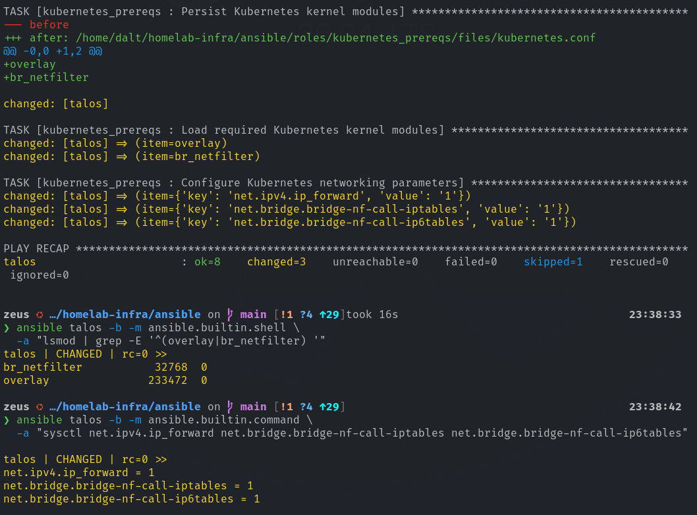
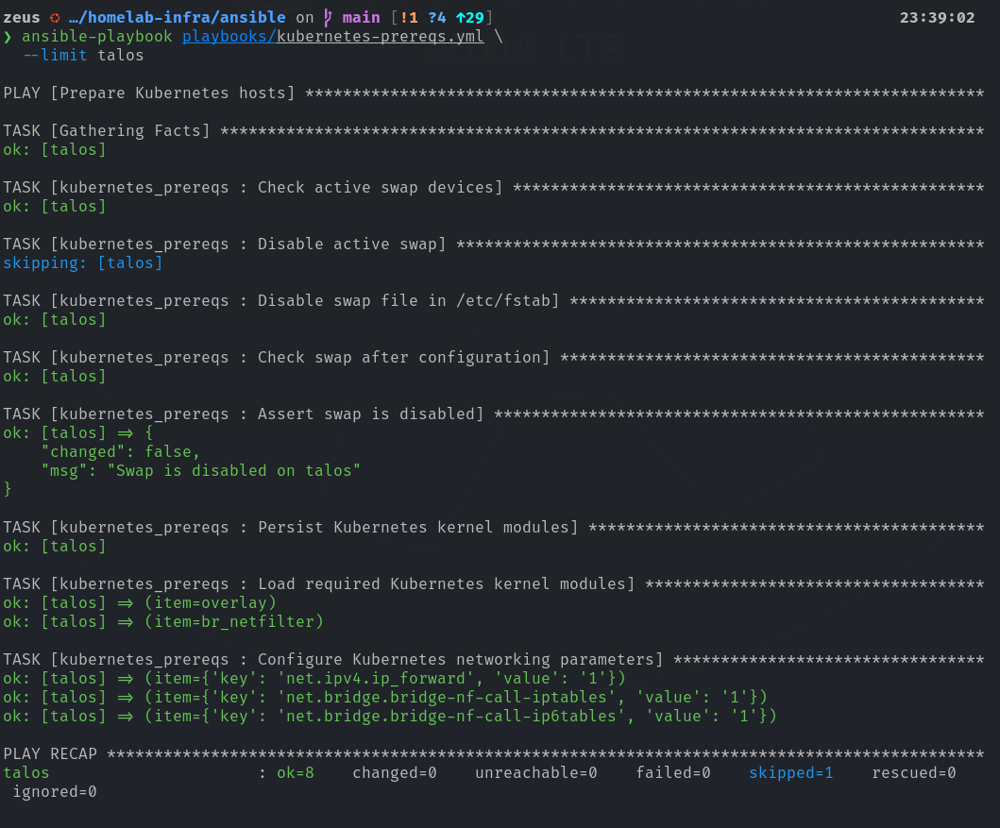
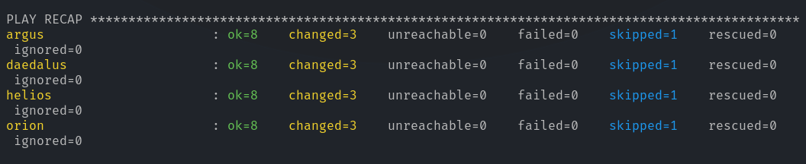
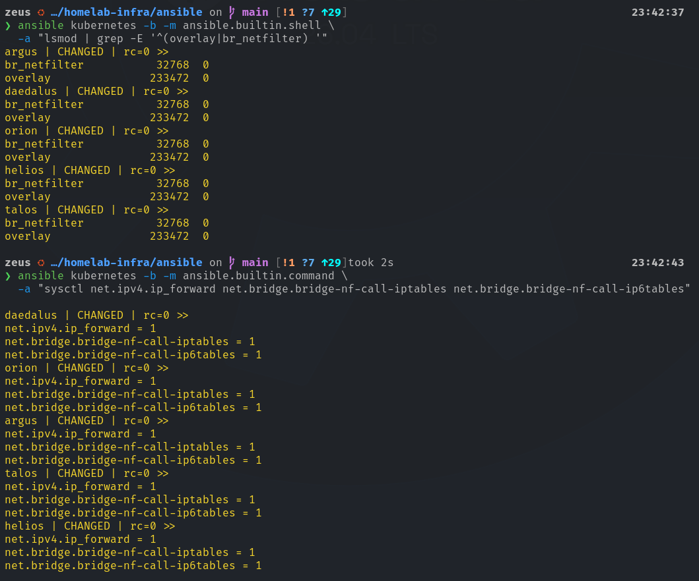
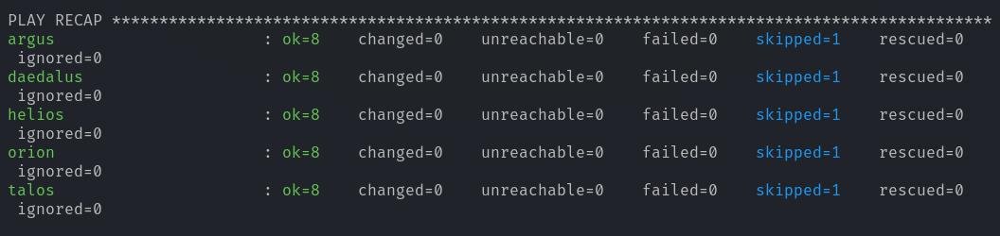

# Kubernetes Host Prerequisites - Ansible Deployment

## 1. Overview

This document describes the automated preparation of five Ubuntu Server hosts for the deployment of an RKE2 Kubernetes cluster within the homelab.

The deployment uses **Ansible** to establish a consistent host-level configuration, replacing repetitive manual administration with declarative, version-controlled configuration management.

The implementation covers:

* Disabling swap at runtime and across reboots
* Persistently loading required Linux kernel modules
* Configuring kernel networking parameters
* Validating configuration changes before deployment
* Using a single host as a deployment canary
* Performing sequential, cluster-wide rollout
* Verifying idempotency and reboot persistence

> [!NOTE]
> This deployment does not install RKE2, configure the Kubernetes control plane, or provision application storage.

### 1.1 Infrastructure Environment

| **Component** | **Configuration** |
| --- | --- |
| Controller | `zeus` |
| Controller OS | Ubuntu-based Linux |
| Ansible Core | 2.21.5 |
| Managed OS | Ubuntu Server 26.04 |
| Managed Hosts | 5 |
| Inventory | [`ansible/inventories/prod/hosts.yml`](/ansible/inventories/prod/hosts.yml) |
| Playbook | [`ansible/playbooks/kubernetes-prereqs.yml`](/ansible/playbooks/kubernetes-prereqs.yml) |
| Role | [`ansible/roles/kubernetes_prereqs/`](/ansible/roles/kubernetes_prereqs/) |

The Ansible controller and inventory were established in [01 — Ansible Controller & Inventory Setup](/docs/deployment/ansible/01-controller-and-inventory.md).

### 1.2 Managed Nodes and Intended Cluster Roles

| **Node** | **Hostname** | **IPv4 Address** | **Intended RKE2 Responsibilities** |
| --- | --- | --- | --- |
| N1 | `talos` | 192.168.33.11 | Dedicated etcd |
| N2 | `helios` | 192.168.33.12 | etcd, control plane, worker |
| N3 | `orion` | 192.168.33.13 | etcd, control plane, worker |
| N4 | `argus` | 192.168.33.14 | Dedicated worker |
| N5 | `daedalus` | 192.168.33.15 | Dedicated worker |

The planned architecture uses **three etcd members, two control-plane instances, and four nodes with worker capability**.

These responsibilities are represented in the Ansible inventory but have not yet been enforced by an RKE2 installation.

## 2. Pre-Deployment Assessment

A read-only inspection was performed before modifying the operating systems. This established a known starting state and identified which prerequisites required automation.

### 2.1 Swap Configuration

The following command inspected active swap on all five nodes:

```bash
ansible k8s -b -m ansible.builtin.command -a "swapon --show"
```

All hosts initially reported the same active swap configuration:

```text
NAME      TYPE SIZE USED PRIO
/swap.img file   4G   0B   -1
```

The swap file was enabled through `/etc/fstab`:

```text
/swap.img    none    swap    sw    0    0
```

**Finding**: All five nodes had a 4 GiB swap file configured and active.

**Decision**: Disable swap at runtime and prevent it from being activated during subsequent boots.

This establishes a consistent swap-disabled configuration for the planned RKE2 deployment, without requiring the swap file itself to be deleted.

### 2.2 Time Synchronization

**Time synchronization was inspected using**:

```bash
ansible k8s -m ansible.builtin.command -a "timedatectl status"
```

**All five nodes reported**:

```text
Time zone: Etc/UTC
System clock synchronized: yes
NTP service: active
RTC in local TZ: no
```

**Finding**: All nodes were synchronized and configured to use UTC.

Consistent system time is particularly important for distributed systems, including Kubernetes control-plane components and etcd.

### 2.3 Kernel Module Assessment

**The initial kernel module check was performed with**:

```bash
ansible k8s -b -m ansible.builtin.shell -a "lsmod | grep -E '^(overlay|br_netfilter) ' || true"
```

No matching loaded modules were reported on any host.

**The modules selected for configuration were**:

| **Module** | **Purpose** |
| --- | --- |
| `overlay` | Provides overlay filesystem support for container storage |
| `br_netfilter` | Exposes bridge traffic to applicable Linux netfilter processing |

**Decision**: Use Ansible to load both modules at runtime and persist their loading configuration across reboots.

### 2.4 Kernel Networking Assessment

**The initial networking assessment checked**:

```bash
ansible k8s -b -m ansible.builtin.command -a "sysctl net.ipv4.ip_forward"
```

**The initial value was**:

```text
net.ipv4.ip_forward = 0
```

The bridge-specific sysctl parameters were initially unavailable because br_netfilter had not been loaded.

**The deployment established the following desired state**:

| **Parameter** | **Initial State** | **Desired State** |
| --- | --- | --- |
| `net.ipv4.ip_forward` | 0 | 1 |
| `net.bridge.bridge-nf-call-iptables | Unavailable | 1 |
| `net.bridge.bridge-nf-call-ip6tables | Unavailable | 1 |

These settings support the intended container networking configuration. Their interaction with the final RKE2 container network interface (CNI) will be reviewed during cluster deployment.

### 2.5 Storage Assessment

The host audit also identified that Ubuntu had provisioned a 100 GiB root logical volume on each node, while a substantial amount of SSD capacity remained available inside the LVM volume group.

| **Host** | **Physical SSD Capacity** | **Root LV** | **Free VG Capacity** |
| --- | --- | --- | --- |
| `talos` | 447.1 GiB | 100 GiB | ~344 GiB |
| `helios` | 465.8 GiB | 100 GiB | ~363 GiB |
| `orion` | 465.8 GiB | 100 GiB | ~363 GiB |
| `argus` | 465.8 GiB | 100 GiB | ~363 GiB |
| `daedalus` | 953.9 GiB | 100 GiB | ~851 GiB |

**The assessment used**:

```bash
ansible k8s -b -m ansible.builtin.command -a "lsblk -o NAME,SIZE,FSTYPE,MOUNTPOINTS"

ansible k8s -b -m ansible.builtin.command -a "vgs"
```

**Decision**: Defer storage allocation to a separate infrastructure design phase.

No partitions, logical volumes, filesystems, or mount points were modified during this deployment.

## 3. Ansible Implementation

### 3.1 Repository Structure

The deployment introduces a dedicated playbook and reusable role inside the existing homelab infrastructure repository.

```text
homelab-infra/
├── ansible/
│   ├── ansible.cfg
│   ├── requirements.yml
│   ├── inventories/
│   │   └── prod/
│   │       └── hosts.yml
│   ├── playbooks/
│   │   └── kubernetes-prereqs.yml
│   └── roles/
│       └── kubernetes_prereqs/
│           ├── files/
│           │   └── kubernetes.conf
│           └── tasks/
│               └── main.yml
└── docs/
    └── deployment/
        └── ansible/
            ├── 01-controller-and-inventory.md
            ├── 02-kubernetes-prerequisites.md
            └── media/
```

The role is responsible for configuring reusable Kubernetes host prerequisites.

The playbook controls inventory targeting, privilege escalation, and execution strategy.

This separation enables the role to be reused without duplicating its task definitions.

### 3.2 Playbook Configuration

**File:** [`ansible/playbooks/kubernetes-prereqs.yml`](/ansible/playbooks/kubernetes-prereqs.yml)

```yaml
---
- name: Prepare Kubernetes hosts
  hosts: k8s
  become: true
  gather_facts: true
  serial: 1

  roles:
    - kubernetes_prereqs
```

The playbook uses the following settings:

| Setting              | Purpose                                           |
| -------------------- | ------------------------------------------------- |
| `hosts: k8s`         | Target all five managed Kubernetes nodes          |
| `become: true`       | Execute privileged configuration tasks using sudo |
| `gather_facts: true` | Collect host information before applying the role |
| `serial: 1`          | Process one managed host at a time                |
| `roles`              | Execute the shared `kubernetes_prereqs` role      |

Sequential execution was selected to limit the scope of any unexpected configuration problem.

The deployment procedure also uses inventory limits to separate initial canary validation from the wider rollout.

### 3.3 Swap Management

**File:** [`ansible/roles/kubernetes_prereqs/tasks/main.yml`](/ansible/roles/kubernetes_prereqs/tasks/main.yml)

Swap management is implemented through four operations:

1. Inspect the currently active swap devices.
2. Disable swap only if active swap is detected.
3. Comment out the existing swap-file entry in `/etc/fstab`.
4. Verify that no active swap remains.

**The active swap check uses**:

```yaml
- name: Check active swap devices
  ansible.builtin.command:
    cmd: swapon --show --noheadings
  register: active_swap
  changed_when: false
  check_mode: false
```

**The registered output determines whether a runtime change is necessary**.

```yaml
- name: Disable active swap
  ansible.builtin.command:
    cmd: swapoff -a
  when: active_swap.stdout | trim | length > 0
  changed_when: true
```

**The `/etc/fstab` entry is managed with a targeted replacement**:

```yaml
- name: Disable swap file in /etc/fstab
  ansible.builtin.replace:
    path: /etc/fstab
    regexp: '^(\s*)(/swap\.img\s+\S+\s+swap\s+.*)$'
    replace: '\1# \2'
    backup: true
```

**This changes**:

```text
/swap.img    none    swap    sw    0    0
```

**To**:

```text
# /swap.img    none    swap    sw    0    0
```

The original file contents are backed up by the Ansible task before modification.

This approach avoids rewriting unrelated filesystem mount entries and retains the existing swap file for potential future recovery.

> [!NOTE]
> **Scope limitation:** This task manages the discovered `/swap.img` entry. It is not intended as a universal policy for every possible swap device or systemd-generated swap configuration.

### 3.4 Swap Verification

After applying the swap configuration, **the role checks for active swap again**.

```yaml
- name: Check swap after configuration
  ansible.builtin.command:
    cmd: swapon --show --noheadings
  register: swap_verify
  changed_when: false
  check_mode: false

- name: Assert swap is disabled
  ansible.builtin.assert:
    that:
      - swap_verify.stdout | trim == ""
    fail_msg: "Swap remains active on {{ inventory_hostname }}"
    success_msg: "Swap is disabled on {{ inventory_hostname }}"
  when: not ansible_check_mode
```

If active swap remains, the assertion fails. The final assertion is skipped during check mode because the dry run does not actually execute `swapoff`.

### 3.5 Persistent Kernel Module Configuration

**File:** [`ansible/roles/kubernetes_prereqs/files/kubernetes.conf`](/ansible/roles/kubernetes_prereqs/files/kubernetes.conf)

```text
overlay
br_netfilter
```

Ansible deploys this configuration to:

`/etc/modules-load.d/kubernetes.conf`

**The corresponding task manages the file's ownership and permissions**:

```yaml
- name: Persist Kubernetes kernel modules
  ansible.builtin.copy:
    src: kubernetes.conf
    dest: /etc/modules-load.d/kubernetes.conf
    owner: root
    group: root
    mode: "0644"
```

This establishes a persistent instruction for loading the modules during system initialization.

### 3.6 Runtime Kernel Module Configuration

The role also loads the kernel modules during the current boot session.

```yaml
- name: Load required Kubernetes kernel modules
  community.general.modprobe:
    name: "{{ item }}"
    state: present
  loop:
    - overlay
    - br_netfilter
```

Persistent configuration and runtime configuration are deliberately separated. The configuration file defines the boot-time desired state, while `modprobe` ensures the current running system is configured without requiring an immediate reboot.

### 3.7 Kernel Networking Configuration

Kernel networking parameters are managed with `ansible.posix.sysctl`.

```yaml
- name: Configure Kubernetes networking parameters
  ansible.posix.sysctl:
    name: "{{ item.key }}"
    value: "{{ item.value }}"
    sysctl_file: /etc/sysctl.d/99-kubernetes.conf
    state: present
    sysctl_set: true
    reload: true
  loop:
    - key: net.ipv4.ip_forward
      value: "1"
    - key: net.bridge.bridge-nf-call-iptables
      value: "1"
    - key: net.bridge.bridge-nf-call-ip6tables
      value: "1"
```

**The resulting configuration is persisted in**:

`/etc/sysctl.d/99-kubernetes.conf`

The module maintains both persistent configuration and active runtime values. The kernel module loading tasks are executed before the sysctl tasks because the bridge-specific parameters depend on `br_netfilter`.

A declarative sysctl module was selected instead of an unconditional `sysctl -p` command to support state convergence and idempotency.

---

## 4. Dependency Management

The role depends on Ansible Core and two Ansible collections.

### 4.1 Tested Versions

| Dependency          | Version  |
| ------------------- | -------- |
| Ansible Core        | `2.21.5` |
| `community.general` | `13.5.0` |
| `ansible.posix`     | `2.2.2`  |

### 4.2 Collection Requirements

**File:** [`ansible/requirements.yml`](/ansible/requirements.yml)

```yaml
---
collections:
  - name: community.general
    version: "13.5.0"

  - name: ansible.posix
    version: "2.2.2"
```

**Install the required collections from the Ansible project directory**:

```bash
ansible-galaxy collection install -r requirements.yml
```

**Verify installed versions**:

```bash
ansible-galaxy collection list
```

During final validation, Ansible Galaxy reported that all requested collections were already installed. The installed versions matched the pinned collection requirements. Ansible Core is a separate Python dependency and must be pinned independently of the collection requirements.

### 4.3 Why Version Pinning Matters

Explicit dependencies improve reproducibility and reduce unexpected behavior caused by upstream version changes. This allows the configuration to be restored or executed from another compatible Ansible controller using the same tested collection versions.

---

## 5. Deployment Procedure

The rollout followed a staged deployment strategy rather than applying changes to every node simultaneously.

### 5.1 Activate the Ansible Environment

```bash
cd ~/homelab-infra
source .venv/bin/activate
cd ansible
```

All commands in this section assume the working directory is [`~/homelab-infra/ansible`](/ansible/).

### 5.2 Syntax Validation

Before modifying any nodes:

```bash
ansible-playbook playbooks/kubernetes-prereqs.yml --syntax-check
```

The syntax check completed successfully. This validates that Ansible can parse the playbook and resolve its referenced tasks and modules. It does not guarantee successful execution against a managed host.

### 5.3 Canary Dry Run

Talos (`192.168.33.11`) was selected as the initial canary host.

```bash
ansible-playbook playbooks/kubernetes-prereqs.yml --limit talos --check --diff
```

The dry run provided a preview of the proposed file and configuration changes without intentionally applying them.

Check mode has limitations for runtime-dependent operations such as loading kernel modules and changing active sysctl values. Consequently, direct runtime validation was required after the real deployment.

### 5.4 Canary Deployment

After reviewing the dry-run output, **the playbook was applied to Talos**:

```bash
ansible-playbook playbooks/kubernetes-prereqs.yml --limit talos --diff
```

Swap configuration was deployed first and independently validated. Kernel module and sysctl configuration were subsequently added to the role and deployed on the same canary host.

**The kernel configuration deployment produced**:

```text
talos : ok=8 changed=3 unreachable=0 failed=0 skipped=1
```



Both kernel modules loaded successfully, and all three sysctl parameters were applied.

### 5.5 Canary Idempotency Validation

**The playbook was executed a second time**:

```bash
ansible-playbook playbooks/kubernetes-prereqs.yml \
  --limit talos
```

**The second execution returned**:

```text
talos : ok=8 changed=0 unreachable=0 failed=0 skipped=1
```



This demonstrates that Ansible recognizes the compliant system state and does not repeatedly modify unchanged configurations.

### 5.6 Deployment to Remaining Nodes

After successful canary validation, **the playbook was deployed to the remaining four nodes**:

```bash
ansible-playbook playbooks/kubernetes-prereqs.yml \
  --limit 'k8s:!talos' \
  --diff
```

The inventory limit excludes Talos, which was already configured. The playbook's `serial: 1` setting ensured that hosts were processed sequentially. The remaining hosts were successfully configured without reported failures.



### 5.7 Cluster-Wide Idempotency Validation

**After rollout, the complete inventory was targeted**:

```bash
ansible-playbook playbooks/kubernetes-prereqs.yml
```

**The final run returned**:

```text
argus    : ok=8 changed=0 unreachable=0 failed=0 skipped=1
daedalus : ok=8 changed=0 unreachable=0 failed=0 skipped=1
helios   : ok=8 changed=0 unreachable=0 failed=0 skipped=1
orion    : ok=8 changed=0 unreachable=0 failed=0 skipped=1
talos    : ok=8 changed=0 unreachable=0 failed=0 skipped=1
```

All five nodes converged successfully.



---

## 6. Runtime Verification

Configuration-file changes alone do not guarantee that the Linux kernel is operating with the required settings. The deployment therefore included direct verification of the running system.

### 6.1 Verify Swap

```bash
ansible k8s -b -m ansible.builtin.command -a "swapon --show"
```

**Expected result:** No active swap devices are listed.

All five nodes returned empty swap output following the deployment.

### 6.2 Verify Kernel Modules

```bash
ansible k8s -b -m ansible.builtin.shell -a "lsmod | grep -E '^(overlay|br_netfilter) '"
```

**The output from each node included**:

```text
br_netfilter           32768  0
overlay               233472  0
```

This confirmed that both kernel modules were loaded.

### 6.3 Verify Kernel Networking Parameters

```bash
ansible k8s -b -m ansible.builtin.command -a "sysctl net.ipv4.ip_forward net.bridge.bridge-nf-call-iptables net.bridge.bridge-nf-call-ip6tables"
```

**Every node returned**:

```text
net.ipv4.ip_forward = 1
net.bridge.bridge-nf-call-iptables = 1
net.bridge.bridge-nf-call-ip6tables = 1
```

This verified that the required networking parameters were active.

### 6.4 Interpretation of Ansible Change Reporting

Ad-hoc `ansible.builtin.command` and `ansible.builtin.shell` operations can report `CHANGED` even when used to execute read-only inspection commands.

For example:

```bash
ansible k8s -m ansible.builtin.command -a "swapon --show"
```

may report `CHANGED` despite making no operating-system modifications.

For the purpose of establishing idempotency, the authoritative result in this deployment is the role's subsequent playbook recap, where all nodes reported `changed=0`.

---

## 7. Reboot Persistence Testing

The final validation tested whether the host configuration survived a complete operating-system reboot.

### 7.1 Talos Canary Reboot

Talos was rebooted first:

```bash
ansible talos -b -m ansible.builtin.reboot -a "reboot_timeout=300"
```

Ansible reported a successful reboot and reconnection. The reboot operation reported approximately 24 seconds of elapsed reboot time.

### 7.2 Post-Reboot Verification

After Talos returned online, the following checks were performed:

* `swapon --show` returned no active swap devices.
* `overlay` and `br_netfilter` were loaded.
* IPv4 forwarding remained enabled.
* Both bridge netfilter parameters remained enabled.

**The prerequisites playbook was then executed again**:

```bash
ansible-playbook playbooks/kubernetes-prereqs.yml --limit talos
```

**Result**:

```text
talos : ok=8 changed=0 unreachable=0 failed=0 skipped=1
```

This confirmed that the canary configuration survived a reboot without requiring Ansible to repair it.

### 7.3 Remaining Node Reboots

**The four remaining nodes were rebooted with Ansible**:

```bash
ansible 'k8s:!talos' -b -m ansible.builtin.reboot -a "reboot_timeout=300" -f 1
```

The `-f 1` option limited concurrent Ansible operations to one host at a time.

All four nodes successfully rebooted:

| Host       | Reported Reboot Elapsed Time |
| ---------- | ---------------------------: |
| `helios`   |                   34 seconds |
| `orion`    |                   28 seconds |
| `argus`    |                   29 seconds |
| `daedalus` |                   29 seconds |



### 7.4 Connectivity Validation

**After the reboots**:

```bash
ansible k8s -m ansible.builtin.ping
```

**All five hosts returned**:

```text
ping: pong
```

This confirmed that every managed host was reachable and able to execute Ansible's Python-based connectivity module.

### 7.5 Final Post-Reboot Convergence

**The full playbook was executed again**:

```bash
ansible-playbook playbooks/kubernetes-prereqs.yml
```

**Final result**:

```text
argus    : ok=8 changed=0 unreachable=0 failed=0 skipped=1
daedalus : ok=8 changed=0 unreachable=0 failed=0 skipped=1
helios   : ok=8 changed=0 unreachable=0 failed=0 skipped=1
orion    : ok=8 changed=0 unreachable=0 failed=0 skipped=1
talos    : ok=8 changed=0 unreachable=0 failed=0 skipped=1
```

No configuration changes were required after reboot. The playbook validated active swap state and reported the module and sysctl configurations as compliant.

The Talos canary additionally received explicit runtime checks before its post-reboot playbook execution.

---

## 8. Engineering Controls and Design Decisions

### 8.1 Declarative Configuration

Persistent settings are maintained in version-controlled Ansible source files.

The playbook can be rerun to reconcile hosts with the intended configuration instead of relying on manual change records.

### 8.2 Idempotency

The role was designed so compliant hosts do not undergo repeated changes. After deployment, all five nodes returned `changed=0` on subsequent executions.

This behavior also persisted through the reboot-validation phase.

### 8.3 Canary-First Deployment

Talos was configured and validated before the remaining nodes.

This limited the potential impact of a task error or unexpected host behavior.

### 8.4 Sequential Execution

The playbook uses `serial: 1`. The remaining-node reboot operation also used a single Ansible fork.

Sequential host execution reduces simultaneous disruption and provides a clearer troubleshooting boundary.

### 8.5 Separation of Responsibilities

The `kubernetes_prereqs` role manages operating-system prerequisites only.

**The following infrastructure responsibilities remain outside its scope**:

* RKE2 installation and cluster bootstrap.
* Control-plane and etcd role assignments.
* API load balancing.
* Container network interface deployment.
* Kubernetes workload scheduling and taints.
* LVM allocation and persistent-volume storage.
* Kubernetes certificates and join-token management.
* Etcd backup and restore.

These areas will be managed in later implementation phases.

### 8.6 Recovery and Troubleshooting

If a future prerequisite change produces an unexpected result, first restrict subsequent executions to a single host.

**Inspect the current runtime values**:

```bash
swapon --show
lsmod | grep -E '^(overlay|br_netfilter) '
sysctl net.ipv4.ip_forward
sysctl net.bridge.bridge-nf-call-iptables
sysctl net.bridge.bridge-nf-call-ip6tables
```

**Review the Ansible-managed configuration**:

```bash
cat /etc/modules-load.d/kubernetes.conf
cat /etc/sysctl.d/99-kubernetes.conf
grep swap /etc/fstab
```

**Review pending playbook changes**:

```bash
ansible-playbook playbooks/kubernetes-prereqs.yml --limit talos --check --diff
```

If `/etc/fstab` needs restoration, use the appropriate backup generated by the Ansible replacement task and validate the mount configuration before rebooting. The playbook intentionally does not delete the existing swap file or alter disk partitions.

---

## 9. Deployment Acceptance Criteria

| Criterion                                   | Result |
| ------------------------------------------- | ------ |
| All five nodes reachable over SSH           | Passed |
| Ansible privilege escalation functional     | Passed |
| Swap disabled on all nodes                  | Passed |
| Swap configuration made persistent          | Passed |
| `overlay` loaded                            | Passed |
| `br_netfilter` loaded                       | Passed |
| IPv4 forwarding enabled                     | Passed |
| IPv4 bridge netfilter enabled               | Passed |
| IPv6 bridge netfilter enabled               | Passed |
| Canary deployment successful                | Passed |
| Canary idempotency verified                 | Passed |
| Cluster-wide idempotency verified           | Passed |
| All five nodes successfully rebooted        | Passed |
| Post-reboot playbook required zero changes  | Passed |
| External Ansible collection versions pinned | Passed |

The prerequisite implementation has met its defined deployment and convergence acceptance criteria.

The storage and Kubernetes installation phases remain pending.

---

## 10. Implementation Summary

Ansible now manages the host-level Kubernetes prerequisites on all five Ubuntu Server systems.

The deployment successfully transitioned the nodes from manually configured operating systems to a shared, declarative configuration baseline.

The primary deliverables are:

* A reusable `kubernetes_prereqs` Ansible role.
* A production-targeted deployment playbook.
* Persistent swap and kernel networking configuration.
* Reproducible Ansible collection dependencies.
* Verified canary-first and sequential deployment procedures.
* Successful cluster-wide convergence and post-reboot validation.

**Final observed state:** Five compliant hosts, zero configuration changes on rerun, zero failed hosts, and zero unreachable hosts.

### Next Implementation Phase

The next phase will focus on storage and RKE2 architecture:

1. Design allocation of the currently unused LVM capacity.
2. Determine the filesystem and mount-point strategy for RKE2 and future persistent volumes.
3. Finalize the Kubernetes API and node-registration endpoint design, including the planned `olympus` endpoint.
4. Automate RKE2 bootstrap according to the three-member etcd topology.
5. Validate control-plane availability, worker registration, etcd health, and cluster-level recovery.

RKE2 installation will begin only after the storage and cluster bootstrap designs have been reviewed.

---

## References

* [Ansible Documentation](https://docs.ansible.com/)
* [Ansible Core Built-in Modules](https://docs.ansible.com/ansible/latest/collections/ansible/builtin/)
* [Ansible POSIX Collection](https://docs.ansible.com/ansible/latest/collections/ansible/posix/)
* [RKE2 Documentation](https://docs.rke2.io/)
* [Linux Kernel Documentation](https://docs.kernel)
