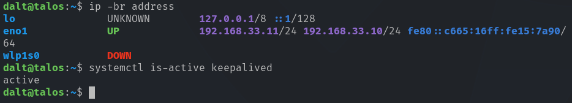
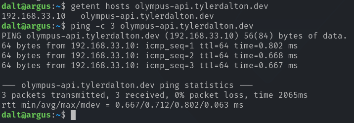
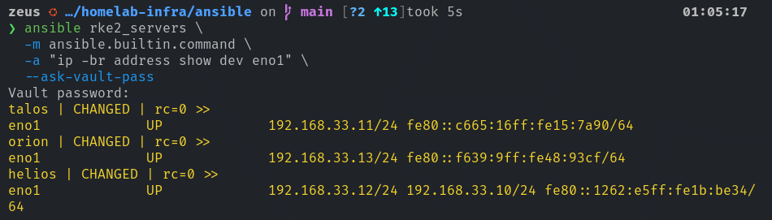
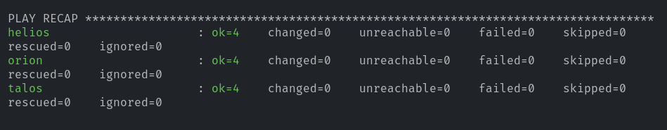

# Olympus API Virtual IP Deployment

## Overview

Olympus is the shared Kubernetes cluster identity. Its stable API and RKE2 registration endpoint is:

| Setting | Value |
| --- | --- |
| DNS name | `olympus-api.tylerdalton.dev` |
| Virtual IP | `192.168.33.10/24` |
| Preferred owner | `talos` |
| Failover order | `helios`, then `orion` |
| RKE2 server nodes | `talos`, `helios`, `orion` |
| RKE2 agent nodes | `argus`, `daedalus` |

The endpoint uses a floating virtual IP managed by Keepalived. It provides a stable cluster entry point without requiring a separate load-balancer host.

> [!IMPORTANT]
> This implementation is active/passive high availability, not active load balancing. Exactly one RKE2 server owns the Olympus VIP at a time.

## Design

Keepalived runs on the three RKE2 server nodes using unicast VRRP over VLAN 33.

```text
olympus-api.tylerdalton.dev
            │
     192.168.33.10
            │
    Floating Keepalived VIP
            │
talos ←→ helios ←→ orion
```

All five Kubernetes nodes resolve and use the Olympus endpoint. The VIP normally resides on Talos because it has the highest VRRP priority. If Talos becomes unavailable, Helios assumes ownership; Orion is the final failover candidate.

HAProxy was installed during early evaluation but is not used in this design. Running a TCP proxy on the RKE2 servers would conflict with the RKE2 registration (`9345`) and Kubernetes API (`6443`) listeners.

## Ansible Implementation

The Olympus VIP configuration is managed in Git:

```text
ansible/
├── inventories/prod/group_vars/rke2_servers/
│   ├── main.yaml
│   └── vault.yml
├── playbooks/
│   └── olympus-vip.yml
└── roles/
    └── olympus-vip/
        ├── defaults/main.yml
        ├── handlers/main.yml
        ├── tasks/main.yml
        └── templates/keepalived.conf.j2
```

Non-secret settings—including the VIP, DNS name, interface, and node priorities—are committed as plain YAML. The Keepalived authentication password is stored in an Ansible Vault-encrypted `vault.yml` file.

The role is scoped to the existing `rke2_servers` inventory group and executes sequentially with `serial: 1`.

## Deployment Validation

### Canary deployment

Talos was selected as the initial deployment canary. Ansible installed or verified Keepalived, rendered the node-specific VRRP configuration, and enabled the service.



### DNS and VIP reachability

From Argus, the Olympus DNS name resolved to the virtual IP and responded to ICMP successfully.



### Failover and fallback

Keepalived was stopped on Talos to simulate failure. The VIP moved from Talos to Helios, confirming that the cluster endpoint remained independent of a single server node.



After Keepalived was restarted on Talos, its higher configured priority caused it to reclaim the VIP.

## Operational Commands

Check VIP ownership:

```bash
ansible rke2_servers \
  -m ansible.builtin.command \
  -a "ip -br address show dev eno1" \
  --ask-vault-pass
```

Check Keepalived service state:

```bash
ansible rke2_servers -b \
  -m ansible.builtin.command \
  -a "systemctl is-active keepalived" \
  --ask-vault-pass
```

Run the Olympus VIP playbook:

```bash
ansible-playbook playbooks/olympus-vip.yml --ask-vault-pass
```

## Acceptance Criteria

- [x] Olympus DNS resolves to `192.168.33.10`.
- [x] Talos owns the VIP during normal operation.
- [x] Argus reaches the VIP through the Olympus DNS name.
- [x] Helios assumes the VIP after Talos Keepalived failure.
- [x] Talos reclaims the VIP after service recovery.
- [x] Full playbook rerun returns `changed=0` on all three RKE2 servers.



## Next Phase

After the final idempotency run, Olympus is ready for RKE2 installation:

1. Bootstrap Talos as the initial RKE2 server.
2. Join Helios and Orion through `olympus-api.tylerdalton.dev:9345`.
3. Join Argus and Daedalus through the same endpoint.
4. Validate etcd quorum, node readiness, and API access through Olympus.
