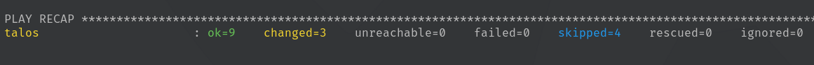
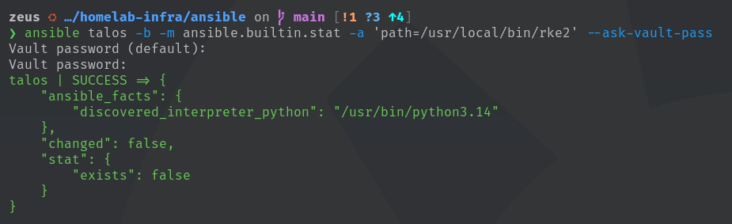

# Olympus RKE2 Bootstrap Preparation

## Overview

This phase prepares the first Olympus RKE2 server, `talos`, for bootstrap and
validates the Ansible plan in check mode. It does **not** install RKE2, start
`rke2-server`, create a Kubernetes cluster, or enroll additional nodes.

The preceding host-prerequisite deployment and Olympus VIP deployment are
documented in [02 — Kubernetes Host Prerequisites](./02-kubernetes-prerequisites.md)
and [03 — Olympus API Virtual IP Deployment](./03-olympus-api-vip.md).

> [!IMPORTANT]
> Check mode is a planning and validation step. A successful run is not
> evidence of a running RKE2 service or Kubernetes API.

## Bootstrap Contract

| Setting | Value |
| --- | --- |
| Bootstrap host | `talos` (`192.168.33.11`) |
| Cluster endpoint | `olympus-api.tylerdalton.dev` |
| Endpoint VIP | `192.168.33.10` |
| Candidate RKE2 release | `v1.37.1+rke2r1` |
| CNI | Cilium |
| Server TLS SANs | `olympus-api.tylerdalton.dev`, `192.168.33.10` |
| Secret handling | RKE2 token is supplied from Ansible Vault |

The candidate release is pinned in role defaults; compatibility remains a
pre-installation decision and is not established by this check-mode run.

## Automation Scope

The bootstrap playbook is [`ansible/playbooks/rke2-bootstrap.yml`](/ansible/playbooks/rke2-bootstrap.yml).
It targets only `talos` and applies the reusable [`rke2` role](/ansible/roles/rke2/).

Before installation, the role:

1. Requires the endpoint, VIP, TLS SANs, Vault-provided token, and a
   version-formatted release value.
2. Resolves `olympus-api.tylerdalton.dev` and requires `192.168.33.10` in the
   returned IPv4 addresses.
3. Plans `/etc/rancher/rke2/` and the token-protected `config.yaml`.
4. Detects whether `/usr/local/bin/rke2` exists and, when absent, plans the
   official installer download using the pinned release and server type.

The normal (non-check-mode) role subsequently installs RKE2, enables
`rke2-server`, waits for the local API on `6443`, and waits for the Talos node
to register. Those operations are outside this validation result.

## Check-Mode Validation

Run from the repository Ansible directory with the project virtual environment
active:

```bash
ansible-playbook playbooks/rke2-bootstrap.yml --check --ask-vault-pass
```

The recorded dry run completed against `talos` with:

```text
ok=9  changed=3  unreachable=0  failed=0  skipped=4
```

The three planned changes are expected preparation actions. The four skipped
tasks include execution-dependent work that cannot establish a running RKE2
service in check mode. At the time of validation, RKE2 was not installed.



## Readiness Boundary

This result confirms only that the bootstrap automation can validate its
declared inputs and produce a non-failing plan for `talos`. Before applying the
playbook, verify the selected release against the supported Kubernetes and OS
matrix, retain the Vault secret outside terminal captures, and confirm that the
Olympus endpoint remains available.

## Authoritative References

- [RKE2 installation methods](https://docs.rke2.io/install/methods)
- [RKE2 high-availability guidance](https://docs.rke2.io/install/ha)
- [RKE2 server configuration reference](https://docs.rke2.io/reference/server_config)
- [RKE2 releases](https://github.com/rancher/rke2/releases)
- [Cilium Kubernetes compatibility](https://docs.cilium.io/en/stable/network/kubernetes/compatibility/)

## Evidence to Add

Capture the evidence after repeating the validation; do not include the Vault
password, token, or rendered `config.yaml`.


